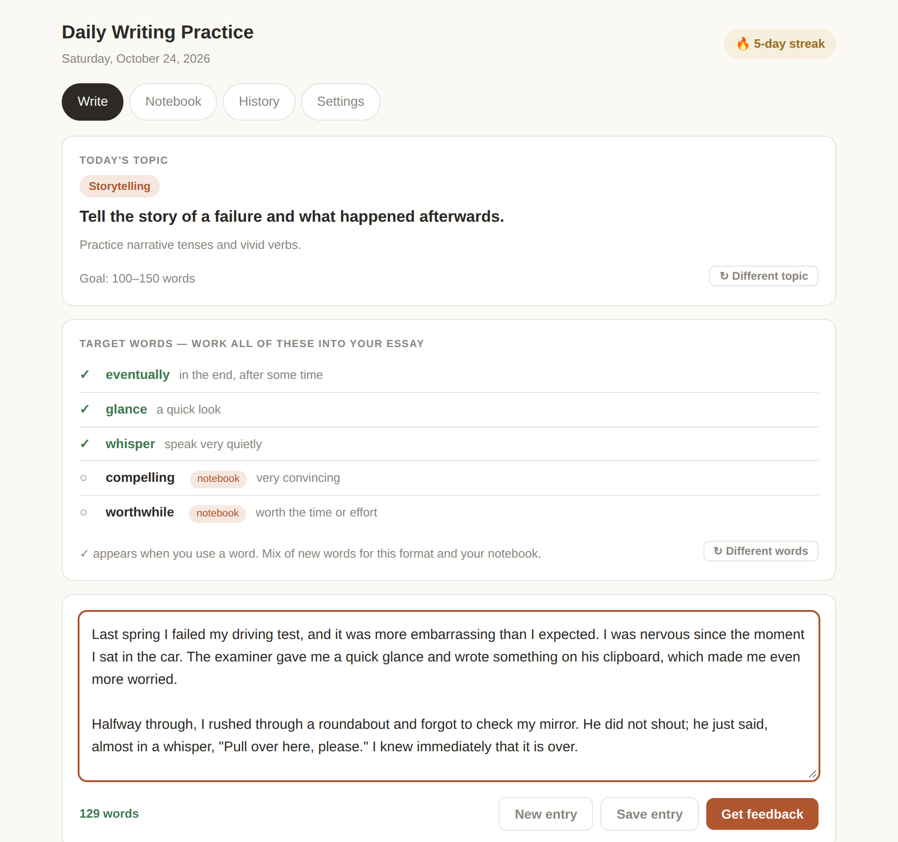
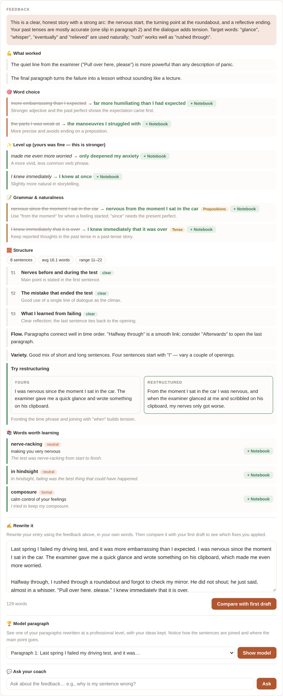
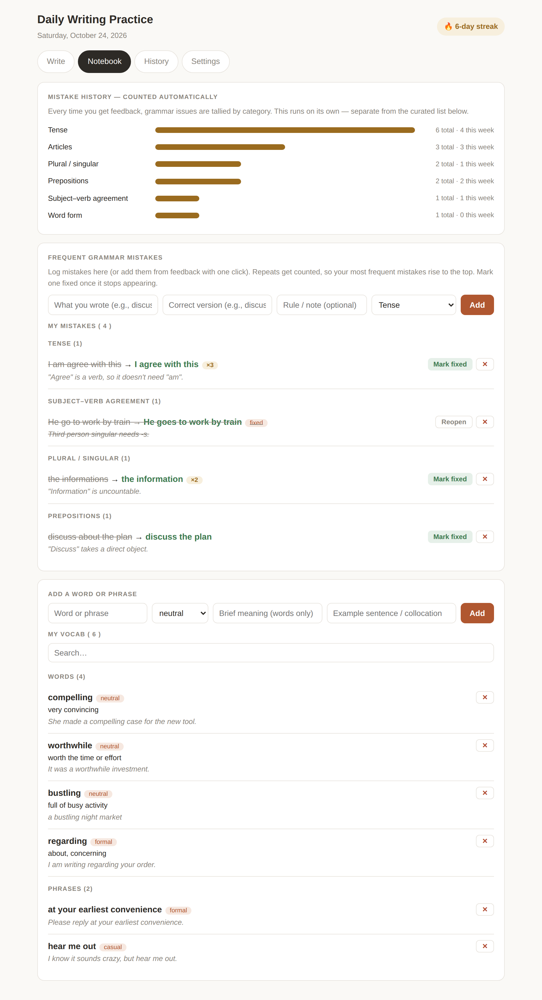
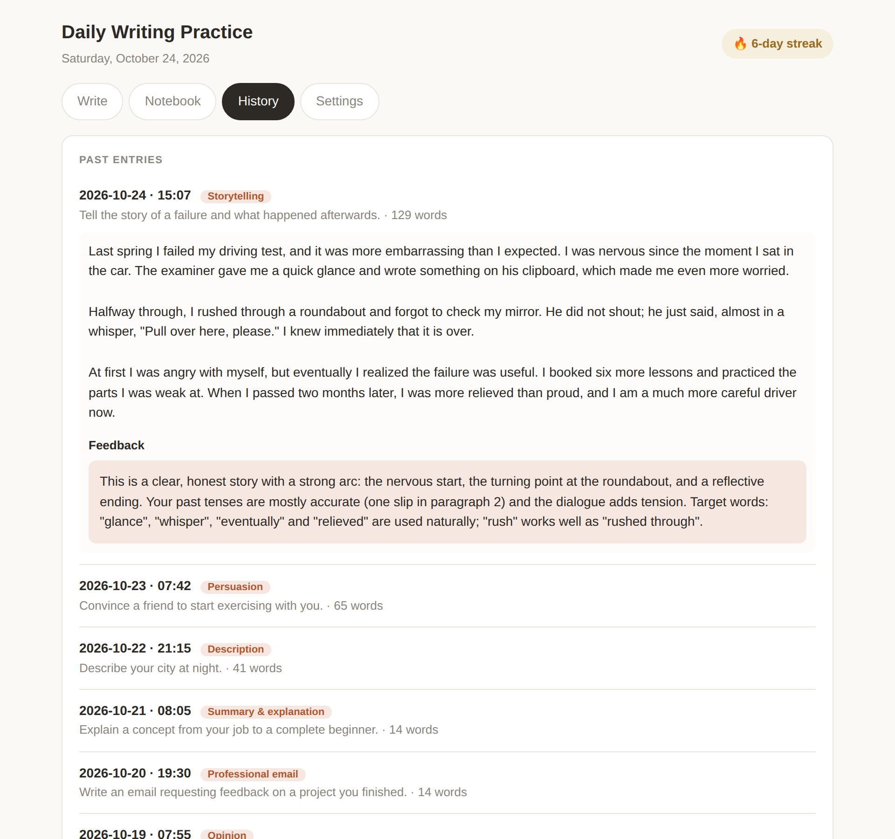
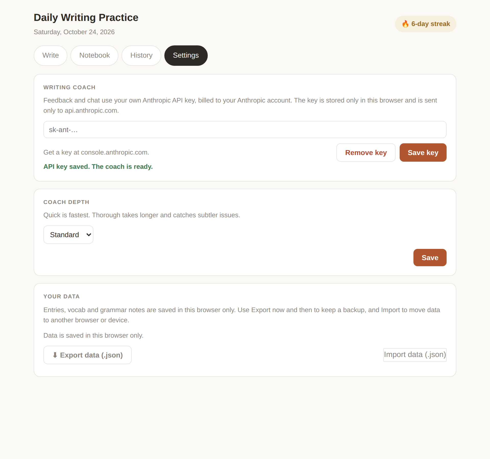
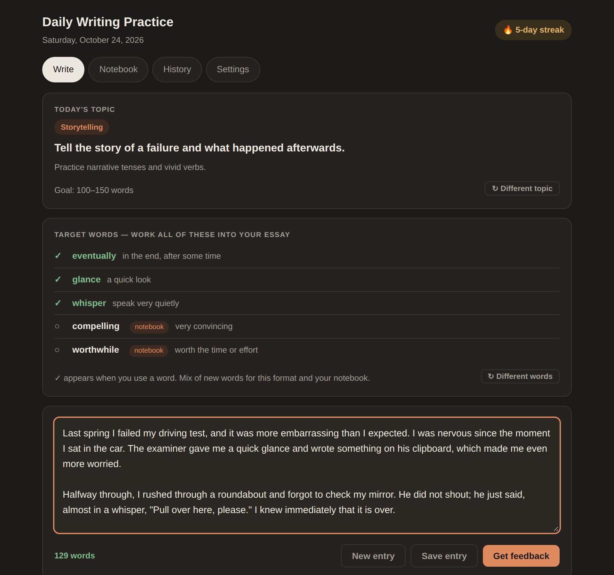

# Daily Writing Practice

A single-page app for daily English writing practice: a topic and format each day, target words to work in, a 100–150 word goal, and an AI writing coach that gives feedback on word choice, grammar and structure.

## Features

- **Write** – daily topic and format, target vocabulary with live ✓ tracking, word count, streak
- **Coach** – feedback, rewrite comparison, model paragraph, and a chat to ask follow-up questions
- **Notebook** – your vocab list and frequent grammar mistakes, plus automatic mistake stats
- **History** – all past entries
- **Settings** – coach depth (Quick / Standard / Thorough), API key, export and import

## Screenshots

### Write

Today's topic, target words that tick off as you use them, and a live word count.



### Coach feedback

Word choice, "level up" suggestions, grammar fixes, structure notes and words worth learning. Any suggestion can go into your notebook with one click. Below the feedback you can rewrite the essay and compare it with your first draft, see a model version of a paragraph, or ask the coach a follow-up question.



### Notebook

Mistake counts by category, your list of frequent grammar mistakes, and your saved words and phrases.



### History



### Settings



### Dark mode

The app follows your system's light or dark setting.



## Running it

There's no build step or dependencies, but the scripts are ES modules, so browsers won't load them from a `file://` URL. Serve the folder locally instead:

```bash
python3 -m http.server 8000   # then open http://localhost:8000
```

Or host it with GitHub Pages:

1. Repo **Settings → Pages**
2. Source: **Deploy from a branch**, branch `main`, folder `/ (root)`
3. Open the URL GitHub gives you

## Writing coach (API key)

Outside Claude, the coach uses your own Anthropic API key:

1. Create a key at [console.anthropic.com](https://console.anthropic.com)
2. Open **Settings** in the app, paste the key, click **Save key**

The key is stored only in your browser's `localStorage` and is sent only to `api.anthropic.com`. Usage is billed to your Anthropic account. Coach depth picks the model:

| Depth    | Model               |
|----------|---------------------|
| Quick    | `claude-haiku-5-5`  |
| Standard | `claude-sonnet-5-5` |
| Thorough | `claude-opus-5-5`   |

To change models, edit `TIER_MODELS` in `js/coach.js`.

## Project structure

```
index.html          page markup
css/styles.css      all styles
js/main.js          entry point: wires up the tabs and loads your data
js/state.js         shared data (entries, vocab, grammar, stats, current feedback)
js/storage.js       saving to localStorage or your Claude account
js/coach.js         writing coach API calls (TIER_MODELS lives here)
js/prompts.js       prompts sent to the coach
js/data/topics.js   daily formats, topics and target-word pools
js/write.js         Write tab: topic, target words, word count, streak, saving
js/feedback.js      feedback card and structure analysis
js/stages.js        rewrite comparison and model paragraph
js/chat.js          follow-up chat
js/grammar.js       grammar notebook and mistake stats
js/vocab.js         vocab notebook
js/history.js       History tab and tab switching
js/settings.js      Settings tab, export and import
js/render.js        redraws every tab
js/html.js          small HTML builders shared by the coach views
js/dom.js, util.js  small shared helpers
```

## Your data

Entries, vocab and grammar notes are saved in your browser's `localStorage`, so they stay on that browser and device. Use **Export data (.json)** for backups and **Import data (.json)** to move to another browser. Import merges and skips duplicates.

The app also still runs as a Claude artifact. There it uses your Claude account for the coach and storage instead.
